<!--
  skyv26 / profile README — dark neon glass system
  Artwork lives in ./assets and is regenerated with:  python3 assets/build_svgs.py .
  Every SVG carries its own dark background, so it reads the same in GitHub light and dark themes.
-->

  

  
  
  
  
  
  
  
  
  
  
  

 

<!-- ═══════════════════════════════ 00 ═══════════════════════════════ -->

> **I don't just write code. I understand problems, design systems, build products, and take them to deployment.**

I'm **Aakash Verma** — Software Engineer, Full-Stack Developer and Forward Deployed Engineer working in **AI systems and product architecture**. I work close to the business problem, in lead, senior-engineering and architecture roles, and carry products from requirements to production.

My path runs from **Electronics & Communication Engineering** and embedded hardware to full-stack platforms, backend and API architecture, SaaS, financial workflows and AI-powered applications. The products below run in **education, water resources, healthcare, astrology and professional services** — from Sierra Leone and Ethiopia to East Africa and India.

<table>
  <tr>
    <td width="50%" valign="top">
      <b>WHAT I BRING</b>  
      ◆ Requirements → architecture → production 
      ◆ Frontend, backend, data and infrastructure 
      ◆ Domain fluency across regulated and specialist fields 
      ◆ AI systems that are useful, safe and explainable
    </td>
    <td width="50%" valign="top">
      <b>HOW I WORK</b>  
      ◆ Understand the business before writing code 
      ◆ Build systems, not short-term hacks 
      ◆ Optimise for long-term maintainability 
      ◆ Teach while building
    </td>
  </tr>
</table>

<i>"Expectations lead to disappointments."</i> — my life's philosophy

  

<!-- ═══════════════════════════════ 01 ═══════════════════════════════ -->

| | Product | Domain | Live |
| :-: | :-- | :-- | :-- |
| **01** | [Edqio](#edqio) | Education technology · SaaS | [edqio.com ↗](https://edqio.com) |
| **02** | [Redwan HydroGeology](#redwan-hydrogeology) | Scientific software · water resources | [redwantcc.com ↗](https://www.redwantcc.com) |
| **03** | [Smile Medical Hospital](#smile-medical-hospital) | Healthcare · institutional | [smiledmi-sl.com ↗](https://www.smiledmi-sl.com) |
| **04** | [Horovista](#horovista) | Astrology · my own product | [horovista.com ↗](https://horovista.com) |
| **05** | [Genuine Consultancy Services](#genuine-consultancy-services) | Professional services | [genuineconsultancyservices.com ↗](https://genuineconsultancyservices.com) |

 

<!-- ─────────────── 01 EDQIO ─────────────── -->

<a href="https://edqio.com"></a>

**Edqio** brings admissions, timetables, attendance, fees, report cards and school-bus operations into one system for single campuses and multi-school groups, built around how East African schools run. A Daad Consulting product, developed with Purple Ocean FZE. **My role:** Forward Deployed Engineer — lead, senior engineering and architecture.

<b>Case study</b> · role-based school operations

 

**The problem.** Schools run on registers, spreadsheets, fee books and phone calls. Each role needs a different slice of the same data, and money and grades need controls, not trust.

<table>
  <tr>
    <th align="left" width="33%">ACADEMICS</th>
    <th align="left" width="33%">FINANCE &amp; CONTROLS</th>
    <th align="left" width="34%">COMMUNITY &amp; TRANSPORT</th>
  </tr>
  <tr>
    <td valign="top">Students, staff, guardians, classes, subjects, rooms Enrollment &amp; admissions Attendance, assignments, exams, grading Timetables Report cards with a <b>QR code</b> anyone can verify</td>
    <td valign="top">Invoices, payments, receipts, balances Invoices sent only after staff review Waivers &amp; scholarships need principal approval <b>Separation of duties</b> — no self-approval Exportable audit trail</td>
    <td valign="top">Parent–teacher–student messaging with a kept record Browser-based parent–teacher meetings Live lesson streaming with attendance Bus routes, stops, schedules &amp; <b>live location</b></td>
  </tr>
</table>

**What makes it technically interesting**

- **Authorisation is a product feature.** Six roles — principal, teacher, parent, student, finance officer, admission officer — each see only their own work; permissions are checked on every request and configurable per school.
- **Maker–checker finance.** The requester of a fee change can never approve it, and every approval lands in an exportable audit trail.
- **Integrity beyond the app.** QR-verifiable report cards let third parties check a document without an account.
- **Real-time operations** — live bus location for parents next to classic records management.

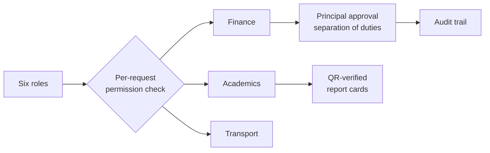

Drawn from publicly documented behaviour — not an internal architecture diagram. Stack observed on the live site: Next.js.

<!-- CONFIRM: modules you led; backend, database and hosting stack. -->

 

<!-- ─────────────── 02 REDWAN ─────────────── -->

<a href="https://www.redwantcc.com"></a>

**Redwan HydroGeology Solutions** is a water-resources consultancy based in Addis Ababa with a branch in Jigjiga. Its platform turns a technical practice — groundwater investigation, feasibility studies, design and construction supervision — into something clients can explore: interactive terrain, a project atlas and a secure client portal. **My role:** Forward Deployed Engineer — lead, senior engineering and architecture.

<b>Case study</b> · scientific visualisation for a water-resources practice

 

**Audience.** Federal and regional government bodies, city administrations, universities, international organisations and private clients.

| Capability | What it does |
| :-- | :-- |
| **Interactive 3D terrain map** | Elevation from SRTM, boundaries from geoBoundaries and Natural Earth; auto-orbit and hover elevation readouts |
| **Elevation profile** | Cross-section of the terrain along the map |
| **Groundwater models** | A cross-section and a rotatable block model explaining aquifer systems |
| **Project atlas** | Assignments filterable by ongoing / completed, each with client, role, duration, location and outputs, linked to map locations |
| **Methodology** | Five stages — desk study, field investigation, drilling & testing, feasibility & design, supervision & administration |
| **Client portal** | Separate secure portal for reports, documents and progress updates |
| **Enquiry builder** | Collects organisation, location and services, then prepares a ready-to-send email |

**What makes it technically interesting.** Real geospatial data in the browser, 3D scientific diagrams that a non-specialist can rotate, and a domain vocabulary — strata, aquifers, pump tests, water balance — presented without dumbing it down.

Stack observed on the live site: Next.js. Data sources: SRTM, geoBoundaries, Natural Earth.

<!-- CONFIRM: 3D/map library, portal stack, hosting, and your scope. -->

 

<!-- ─────────────── 03 SMILE ─────────────── -->

<a href="https://www.smiledmi-sl.com"></a>

**Smile Medical Hospital** is a registered hospital in Freetown, Sierra Leone. Its platform brings medical and dental services, a diagnostic laboratory, health and motor insurance, outreach and patient enquiries together on one site. **My role:** Forward Deployed Engineer — lead, senior engineering and architecture.

<b>Case study</b> · one front door for a multi-service institution

 

<table>
  <tr>
    <td width="50%" valign="top">
      <b>PATIENT JOURNEYS</b> 
      14 services — cardiology, paediatrics, surgery, laboratory, dental, dental CAD/CAM lab, internal medicine, maternity, radiology, pharmacy, wards, ICU, emergency, OPD 
      Laboratory test menu in four groups · book a test 
      Book an appointment · sign in · registration 
      Health and motor insurance cover · request a quote
    </td>
    <td width="50%" valign="top">
      <b>PLATFORM</b> 
      Contact form with required fields and <b>Cloudflare Turnstile</b> 
      About, medical, dental, laboratory, insurance, outreach, gallery, experts, FAQs 
      Privacy, terms and <b>patient-rights</b> pages 
      Media through Cloudinary and Next.js image optimisation
    </td>
  </tr>
</table>

Emergency contact and hours come first; every path then ends in a booking or enquiry action. Patients, families, insurance customers and charity partners each get their own route.

Stack observed on the live site: Next.js · Vercel · Cloudinary · Cloudflare Turnstile.

<!-- CONFIRM: what sits behind sign-in / registration / booking, and your scope. -->

 

<!-- ─────────────── 04 HOROVISTA ─────────────── -->

<a href="https://horovista.com"></a>

**My own product and business.** Horovista turns a birth date, time and place into a personalised North Indian Vedic astrology **book** — read online or as a PDF, in English or Hindi. I designed, built and run it, and as a part-time astrologer I review the readings myself.

<b>Case study</b> · from birth data to a personal book

 

<table>
  <tr>
    <td width="36%" valign="top"><b>THE BOOK</b> 14 chapters Dasha life timeline Lal Kitab reading &amp; remedies Gemstone guidance 3D page-turn reader Standard + 8 designed editions</td>
    <td width="32%" valign="top"><b>FREE TOOLS</b> Daily horoscope Panchang by city Festival calendar · good-days finder Moon sign · Kundli Milan Lo Shu grid · planets · journal</td>
    <td width="32%" valign="top"><b>BUSINESS</b> Paid reports &amp; full book Checkout with discount codes Email sign-in, private charts English / हिंदी Add-to-home-screen web app</td>
  </tr>
</table>

- **Deterministic domain computation** — charts, Dasha periods, Panchang and matching must be reproducible from date, time and location.
- **Personalised content at scale** — every reading assembles into a two-language, 14-chapter book with a page-turn reader and PDF export.
- **Responsible scope** — no predictions of death or lifespan; no medical, legal or investment instructions.
- **Ask-your-book** — readers can ask their book questions. <!-- CONFIRM: AI-assisted? If yes, describe the approach. -->

Stack observed on the live site: Next.js · Cloudflare Turnstile · first-party analytics + Google Analytics with consent.

 

<!-- ─────────────── 05 GENUINE ─────────────── -->

<a href="https://genuineconsultancyservices.com"></a>

**Genuine Consultancy Services** — a deployed, client-facing business website that takes a visitor from positioning to services to enquiry. **My role:** Forward Deployed Engineer.

<!-- CONFIRM: services, page structure, contact workflow and stack — the site blocks automated readers, so none of this was verified. -->

 

<!-- ═══════════════════════════════ 02 ═══════════════════════════════ -->


Ongoing R&D — not a released product. LLM integration · RAG and embedding pipelines · tool calling · multi-step agent workflows · contextual assistants · intelligent reporting · local (Ollama) and cloud model experimentation.

 

<!-- ═══════════════════════════════ 03 ═══════════════════════════════ -->



<b>Application Engineering</b> — frontend, backend, APIs, data, authentication

 

| Capability | Evidence |
| :-- | :-- |
| Role-based access, per-request authorisation | Edqio — six roles, every request checked |
| Authenticated accounts & portals | Horovista sign-in · Smile sign-in & registration · Redwan client portal |
| Multi-language product | Horovista — English and Hindi |
| Production web frontends | Edqio · Redwan · Smile · Horovista |

<b>Fintech & Financial Applications</b> — payments, financial workflows, controls

 

| Capability | Evidence |
| :-- | :-- |
| Invoicing, payments, receipts, balances | Edqio — fee management |
| Maker–checker approvals, audit trail | Edqio — principal sign-off, separation of duties |
| Paid products and checkout | Horovista — paid reports, discount codes |

<b>Education & Institutional Software</b> — administration and organisational workflows

 

| Capability | Evidence |
| :-- | :-- |
| School administration end to end | Edqio |
| Verifiable documents | Edqio — QR-verified report cards |
| Institutional platforms | Smile Medical Hospital · Redwan HydroGeology |
| Business web presence | Genuine Consultancy Services |

<b>Scientific & Specialised Applications</b> — domain-specific software

 

| Capability | Evidence |
| :-- | :-- |
| Geospatial & terrain visualisation | Redwan — 3D terrain from SRTM, elevation profiles, project map |
| Scientific diagrams | Redwan — groundwater cross-section and rotatable block model |
| Deterministic domain calculations | Horovista — charts, Dasha timelines, Panchang, matching |

<b>AI & Intelligent Systems</b> — LLMs, RAG, assistants, tool calling

 

| Capability | Evidence |
| :-- | :-- |
| Q&amp;A over personal content | Horovista — ask-your-book (approach to be documented) |
| RAG, tool calling, agents, reporting | AI R&amp;D lab |
| Local and cloud model serving | Ollama and cloud API experiments |

<b>Infrastructure & Delivery</b> — hosting, delivery, protection

 

| Capability | Evidence |
| :-- | :-- |
| Five products in production | Edqio · Redwan · Smile · Horovista · Genuine |
| Edge hosting & media delivery | Smile — Vercel, Cloudinary |
| Bot protection | Smile and Horovista — Cloudflare Turnstile |
| Analytics with consent | Horovista |

 

<!-- ═══════════════════════════════ 04 ═══════════════════════════════ -->


| Layer | Tools | Where it shows up |
| :-- | :-- | :-- |
| **Frontend** |  | Edqio · Redwan · Smile · Horovista (Next.js observed) · PWA, SSR/ISR, component systems |
| **Backend & APIs** |  | REST services, service layers, RBAC/JWT, rate limiting |
| **Data** |  | Relational & document stores, caching, indexing |
| **AI** |  | LLMs, RAG, embeddings, vector DBs (Pinecone, Weaviate, pgvector), Ollama, OpenClaw |
| **Desktop** |  | Cross-platform desktop exploration |
| **Infrastructure** |  | Smile on Vercel · Turnstile on Smile and Horovista · Docker, CI/CD |
| **Embedded** |  | Firmware, sensor-to-cloud, hardware-to-API — my ECE roots |

 

<!-- ═══════════════════════════════ 05 ═══════════════════════════════ -->



<b>Same blueprint as a Mermaid diagram</b>

 

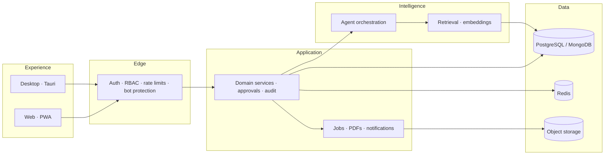

 

<!-- ═══════════════════════════════ 06 ═══════════════════════════════ -->


<table>
  <tr>
    <td width="50%" align="center">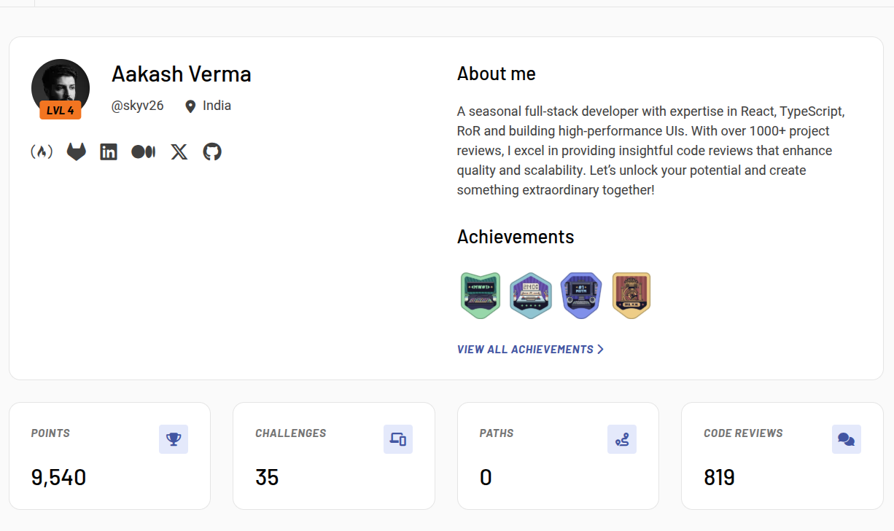 <b>Frontend Mentor performance</b></td>
    <td width="50%" align="center">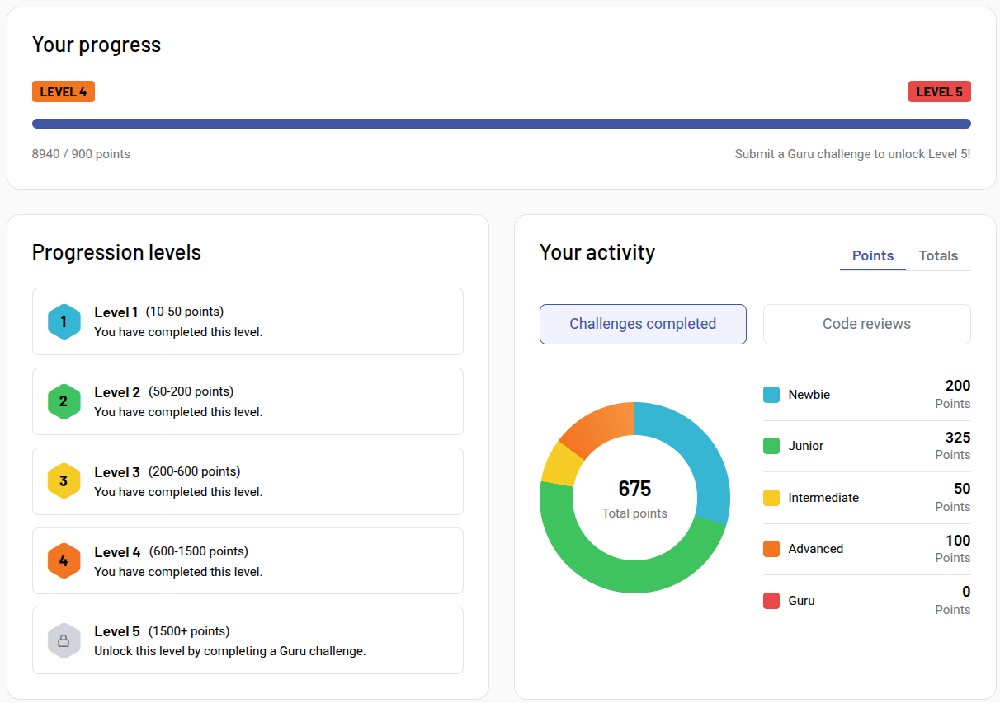 <b>Continuous learning</b></td>
  </tr>
</table>

  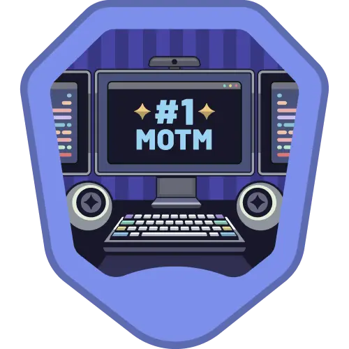
  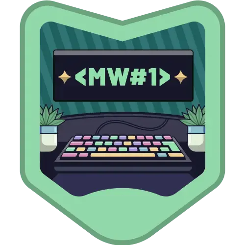
  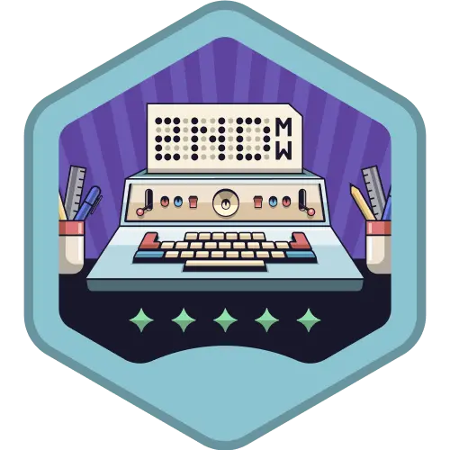
  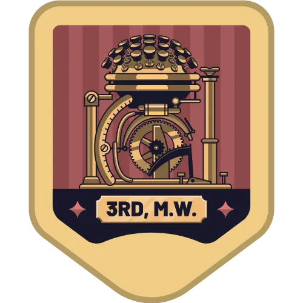

 

<!-- ═══════════════════════════════ 07 ═══════════════════════════════ -->


  
  

  

  

  

 

<!-- ═══════════════════════════════ 08 ═══════════════════════════════ -->


| Essay | Theme |
| :-- | :-- |
| [**The Clockmaker's Dilemma**](https://skybrel.medium.com/the-clockmakers-dilemma-a-story-about-humans-in-the-age-of-ai-6133366a73fa) | Preserving humanity in automated systems |
| [**Friend or Foe?**](https://skybrel.medium.com/friend-or-foe-the-invisible-game-of-technology-c06987e6c2ac) | The hidden influence of technology |
| [**The Happy Developer**](https://skybrel.medium.com/how-to-be-the-happiest-software-developer-bcae8a663ca6) | Sustainable fulfilment in engineering |

 

<!-- ═══════════════════════════════ 09 ═══════════════════════════════ -->


<a href="https://open.spotify.com/artist/2dGQpFvIvy3tANrmozUd1n"></a>

  
  
  
  
  

 

<!-- ═══════════════════════════════ 10 ═══════════════════════════════ -->


<b>Building something that has to work in the real world? Let's talk.</b>

  
  
  
  
  
  

  

<a href="#top"></a>
